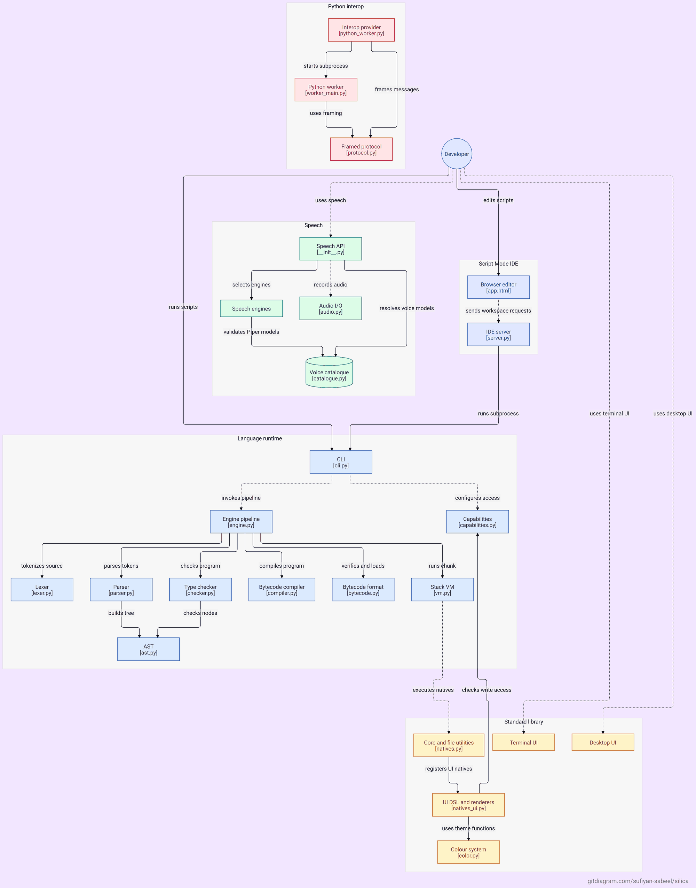

<p align="center">
  
</p>

# Silica — official website

The official website for [Silica](https://github.com/sufiyan-sabeel/silica), an
open-source general-purpose programming language created by Umaiz Sufiyan.

**Live at [sufiyan-sabeel.github.io/silica-website](https://sufiyan-sabeel.github.io/silica-website/)**
**Language repository: [github.com/sufiyan-sabeel/silica](https://github.com/sufiyan-sabeel/silica)**

## What this is

A static site served by GitHub Pages straight from `main`: plain HTML, one
stylesheet, two small scripts, no framework and no bundler. A push is a deploy.

```
index.html                 homepage (hero 3D, features, playground, roadmap, …)
docs/*.html                thirteen documentation pages
assets/css/site.css        the whole design system ("Silica Midnight")
assets/js/site.js          theme, nav, tabs, copy, search, live repo status
assets/js/crystal.js       the hero crystal — hand-written WebGL, no library
assets/img/                logo, mark, icons, social card
assets/search-index.json   generated index for the documentation search
sitemap.xml robots.txt     search-engine plumbing
404.html                   not-found page
tools/                     the generator that produced everything above
```

## The 3D hero

`assets/js/crystal.js` draws an icosahedron with raw WebGL: two translucent
shells (back faces, then front faces), an inner solid, and edge lines, lit by a
key light plus a fresnel rim. No three.js, no model file, no network request.

It is deliberately defensive: device pixel ratio capped at 2, rendering stops
when the canvas leaves the viewport or the tab is hidden, `prefers-reduced-motion`
renders one still frame, and if WebGL is unavailable the inline SVG fallback in
`index.html` stays on screen. `tools/crystal_svg.py` generates that fallback from
the same geometry, so the two views are the same object.

## Live repository status

The homepage carries a status board: latest release, last commit, stars, forks and
open issues, read from the public GitHub API in the visitor's browser. The build
bakes the same values in as a fallback, so the page is correct with JavaScript
disabled and honest when the API is rate-limited.

`tools/fetch_repo_status.py` captures stars, forks, open issues, the latest
release and the last push into `tools/repo_status.json`. The build bakes those
values into the page, and `site.js` refreshes them from the public GitHub API on
load — no token, no backend. If the API is rate-limited the baked values and their
timestamp stand.

## Editing

Edit the HTML in place, or regenerate it:

```
tools/build_site.py        page chrome, docs layout, search index, sitemap
tools/pages_home.py        homepage sections
tools/pages_docs.py        documentation pages
tools/snippets.py          every code example, in one place
tools/verify_snippets.py   runs each example against the real toolchain
tools/crystal_svg.py       the SVG fallback for the hero
tools/check_site.py        links, metadata, structure, overflow
```

Every code example on the site is executed against the Silica implementation
before publication, so the documentation cannot drift from the language.

## Accessibility and performance

Semantic landmarks, a skip link, keyboard-operable tabs and search, visible focus
states, `prefers-reduced-motion` support, a light and dark theme, no layout shift
from the canvas, and no third-party scripts. Inter and JetBrains Mono are loaded
from Google Fonts with `display=swap`; the design falls back to the system stack
if that request fails.

## Licence

MIT, like Silica itself. Copyright (c) 2026 Umaiz Sufiyan.
